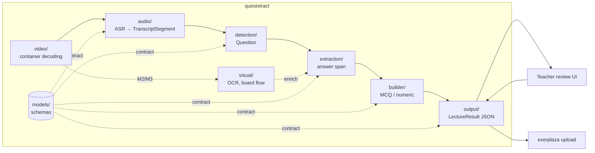

# Architecture review — M1 package foundation

Working document for the project report. It records *why* the architecture in
[architecture.md](architecture.md) looks the way it does: the drivers, the decisions, the
alternatives we rejected, and what an independent review changed. Each section notes which
report chapter it feeds (numbering follows the TDT4290 compendium's suggested structure).

## 1. Drivers (→ report ch. 4 pre-study, ch. 6 requirements)

Four things shaped the design, roughly in order of weight:

1. **The customer's end-to-end vision.** The brief is not "detect questions"; it is detect →
   extract question *and* solution → store → review → upload to exerplaza. An architecture
   that only fits M1 would have to be reworked twice.
2. **The roadmap's modality shift.** M1 is audio-only; M2/M3 add slide/board understanding
   that *enriches* the audio questions; M4 renders animations. The seams between stages had
   to be placed where those modalities join, not where today's code happens to split.
3. **How the team works.** Five people, ten weeks, two-week sprints, and issues #6–#18
   assigned to different members in parallel. Module boundaries double as ownership
   boundaries: an issue owner must be able to build inside one package against a fixed
   contract without stepping on anyone else.
4. **Course quality bar.** Modular, testable, installable on three OSes × four Python
   versions, with CI gates (tests ≥ 70 % coverage, ruff, mypy strict) on every PR.

Quality attributes we prioritised, in order: **modifiability** (M2–M4), **testability**
(each stage in isolation), **portability** (stdlib-only core, no native deps yet),
**interoperability** of the output (JSON as the contract with the review UI and exerplaza).
We deliberately did *not* optimise for throughput; hour-long lectures are batch jobs.

## 2. The shape in one picture (→ report ch. 7, figure)

Solid arrows exist or are M1 issues; dashed ones are M2+ or planned. `models/` is not a
stage: it is the typed contract every stage reads and writes.

## 3. Decisions and alternatives (→ report ch. 7)

Each entry: what we chose, what else we considered, why, and the cost we accepted.

### D1 — A package per pipeline stage

*Chose:* `video/ audio/ detection/ models/ output/` (+ planned `visual/ extraction/ builder/`),
one responsibility each, `pipeline.py` as the only place that knows the order.

*Alternatives:* (a) keep the flat M0 layout (`models.py`, `detect.py`, `cli.py`); (b) split
by *feature* (e.g. `quiz/`, `transcript/`) rather than by stage.

*Why:* the stages are exactly the units that will be swapped (heuristic → classifier, Whisper
→ another ASR, OCR engine) and exactly the units the issues are cut along. A flat layout
would have five people editing the same files; feature packages would cut across the data
flow and make the M2 "enrich" step live in two places.

*Cost:* more directories than ~200 lines of code strictly needs today; a few `__init__.py`
files that are only docstrings. We judged the ownership clarity worth it.

### D2 — `video/` is not `audio/`

*Chose:* container decoding (mp4 → audio track, later → frames) lives in `video/`; `audio/`
is speech-to-text only.

*Alternative:* issue #5's original sketch put `extraction.py` (mp4 → audio) under `audio/`.

*Why:* M2/M3 need frames from the same container. With decoding under `audio/`, the visual
package would import from `audio/` (a name-inverted dependency) or duplicate mp4 handling.
This was a review finding (§5), not the first draft.

### D3 — Frozen, keyword-only dataclasses as the inter-stage contract

*Chose:* `Word`, `TranscriptSegment`, `Question`, `LectureResult` in `models/schemas.py`,
`frozen=True, kw_only=True`, with `from_dict`/`to_dict` and a single `SchemaError`.

*Alternatives:* plain dicts; `TypedDict`; pydantic models.

*Why:* dicts push validation to every consumer and defeat mypy; pydantic would be the first
runtime dependency for something the stdlib does adequately at this size, and it would
couple every stage to one library's version. Keyword-only construction removes a whole class
of silent bugs when fields are added (a review finding showed `Question(...)` with positional
arguments would have stored the reasons tuple in the new `source` field without error).
Validation happens once, at the JSON boundary, and raises one error type the CLI can render.

*Cost:* hand-written `from_dict` per type. Acceptable at four types; revisit if the schema
grows past ~ten.

### D4 — `LectureResult` envelope and stable `Question.id`

*Chose:* the export unit is one recording — `{"lecture", "questions": [...]}` — and each
question carries an `id` derived from `start` + text.

*Alternative:* a bare list of questions (M0 behaviour).

*Why:* the two downstream consumers both need identity: the review UI edits a question and
re-exports it; the exerplaza integration must *update* the quiz for a video, not create a
duplicate. Text is the field being edited, so it cannot be the key. Deriving `id` from
position and text keeps it deterministic across re-runs of the same recording without
needing a database.

*Cost:* an ASR re-run that shifts timestamps or words changes ids. We accept this: ids are
stable per *transcript*, and the transcript is persisted (D8) precisely so it is not re-run.

### D5 — Forward-compatible schema: `source`, `words`, reserved fields

*Chose:* add `Question.source` (detector provenance) and `TranscriptSegment.words`
(per-word timestamps) now; document `visual_context`, `topic`, `answer` as reserved.

*Why:* every one of these is an *additive* change today and a *breaking* change once the
review UI and exerplaza mapping depend on the JSON. `words` in particular is what
sentence-accurate timestamps (FR7) need, and asking the ASR stage (#8) for them from day one
is free; retrofitting is not. We explicitly framed M2 as enrichment — visual understanding
fills `visual_context` on existing questions rather than emitting a second set — because the
roadmap and the brief say so, and because a second detector would need a merge step nobody
owns.

### D6 — Where the package ends

*Chose:* inside — everything from decoding to quiz items on disk, *including* the planned
solution extraction and question builder. Outside — the review UI, exerplaza upload, and the
evaluation dataset.

*Why:* solution extraction needs the transcript segments *after* each question; if it lived
in the UI, the UI would re-implement pipeline logic. The UI and uploader, by contrast, only
need the JSON. The evaluation set is test material, not runtime code.

*Tension to argue in the report:* general_requirements.md says the system "shall not create
questions on its own, only extract from questions asked", while the brief asks for a builder
producing MCQ/numeric items. Our reading: the builder *formats* an asked question (adds
distractors, normalises notation); it never invents a question. Confirm with the customer.

### D7 — Heuristic detector first, pluggable later

*Chose:* keep the M0 keyword heuristic (`?`, wh-word, auxiliary-verb start) as
`detection/questions.py`, behind a function signature a classifier can replace.

*Why:* NFR2 sets the bar at ≥ 50 % recall on *our own* labelled set, which does not exist yet
(#11). Building a classifier before the evaluation set exists would be optimising blind. The
heuristic gives the rest of the pipeline something real to run on and gives #11/#12 a
baseline to beat. The literature we collected points the same way: the hard part of
video-based question generation is context selection on noisy ASR text, not the classifier.

### D8 — Persist the transcript; never recompute ASR for an edit

*Chose:* `audio/transcripts.py` reads and writes transcript JSON as a first-class artifact.

*Why:* ASR is the expensive step (minutes per lecture, GPU if available). Edits, re-detection
with another threshold, and later enrichment must all run from the saved transcript. This is
also the sustainability argument (§7): compute once.

### D9 — Errors at the boundary, readable at the CLI

*Chose:* `SchemaError` raised by `from_dict`/`read_*`; the CLI catches it (and `OSError`) and
prints one line, exit code 1.

*Why:* issue #17 requires readable errors and the first real users are lecturers, not
developers. Internally we still fail fast — no silent defaults.

### D10 — Quality gates are part of the architecture

*Chose:* uv for builds, ruff (lint + format), mypy `--strict`, pytest with a 70 % coverage
gate and `--import-mode=importlib`, CI on Linux/macOS/Windows × Python 3.10/3.13. Planned
modules are *not* scaffolded; the owning issue creates them against the documented boundary.

*Why:* with five part-time contributors the type checker and the tests are the review
capacity we do not have. The import mode choice is small but prevents a known pytest failure
(same-named test files in mirrored directories) that would otherwise appear the first time
`tests/integration/` is added.

## 4. Requirements traceability (→ report ch. 6)

| Requirement (general_requirements.md) | Where it lands | Status |
|---|---|---|
| FR1 accept `.mp4` | `video/` (#7) | planned |
| FR2 extract audio track | `video/audio.py` (#7) | planned |
| FR3 transcribe with ASR | `audio/transcription.py` (#8) → `TranscriptSegment` | planned |
| FR4 extract drawing/animation from video | `video/frames.py`, `visual/` (M2/M3) | roadmap |
| FR5 teacher can edit after extraction | package side: JSON round-trip via `read_result`/`write_result`; the editing UI itself is #15, a separate app (D6) | partial — round-trip only |
| FR6 identify question sentences | `detection/questions.py` (#10) | M0 heuristic |
| FR7 start timestamp per question | `Question.start`; sentence-accurate once `words` are used | segment-level today |
| FR8 export JSON | `output/serialize.py`, `LectureResult` (#13) | M0 placeholder |
| FR9 progress for long recordings | `progress.py` protocol (#14), threaded by `pipeline.py` | planned |
| FR10 show detection confidence | `Question.confidence` + `reasons` | M0 placeholder |
| FR11 filter by time/topic | `LectureResult.filter()` (#16); `topic` reserved | planned |
| NFR1 Python ≥ 3.10, Linux/macOS/Windows | CI matrix, stdlib-only core | done |
| NFR2 recall ≥ 50 % on labelled set | #11 dataset, #12 evaluation under `tests/` | planned |
| NFR3 docstrings, type hints, tests, ≥ 70 % coverage | ruff `D` rules, mypy strict, pytest gate | done |
| NFR4 tested on every PR | GitHub Actions (#19) | done |
| Constraint: never invent questions | detector only extracts verbatim sentences; builder formats, never generates (D6) | by design |

## 5. The review and what it changed (→ report ch. 7, ch. 12 "AI")

Before merging the M1 layout we ran a structured, AI-assisted review of the architecture
PR: ten independent "finder" passes (line-by-line, removed behaviour, cross-file callers,
language pitfalls, reuse, simplification, efficiency, altitude/fit, conventions), each
candidate then checked by a separate verifier against the code, the issues and the customer
brief, then a final sweep for gaps. 22 candidates were verified, one refuted, 15 applied.

What it changed, in order of consequence:

| Finding | Change | Decision affected |
|---|---|---|
| Solution extraction and question builder had no home | added as planned stages; `answer` reserved | D6 |
| Video decoding filed under `audio/` | `video/` package; `audio/` = ASR only | D2 |
| No identity for edits/upload | `Question.id`, `LectureResult` envelope | D4 |
| Word timestamps dropped at the ASR boundary | `Word`, `TranscriptSegment.words` | D5 |
| `source` framed M2 as a second detector | documented as enrichment via `visual_context` | D5 |
| Positional construction would silently misassign a new field | `kw_only=True` | D3 |
| Malformed transcripts produced tracebacks | `SchemaError` + one-line CLI errors | D9 |
| Nested test dirs would collide on same-named files | `--import-mode=importlib` | D10 |
| Transcript I/O lived in `output/`; no way to persist transcripts | `audio/transcripts.py` | D8 |
| Progress reporting (#14) unplaced | `progress.py` row, stages accept a reporter | — |
| Status table said "done" for open issues; README contradicted the non-goals; rename unflagged | doc/README/CHANGELOG corrections | — |
| Non-ASCII first word skipped by the tokeniser; int confidence at threshold 0 | `\w+` + `casefold()`, float seed | D7 |
| `output/json.py` shadowed the stdlib module | renamed `serialize.py` | — |

The one refuted candidate ("the empty `audio/` package contradicts the no-scaffolding rule")
is worth mentioning in the report as an example of why verification matters: the rule is about
planned *modules*; package boundaries are deliberately created early.

**Reflection for the AI section.** The review's value was not bug-finding — the diff was a
reorganisation with almost no logic — but *fit-checking the design against documents the code
cannot see*: the customer brief, the open issues, the roadmap. That is the part of a review a
student team most often skips under time pressure. Two responsible-use points: every finding was
verified against a concrete line, issue or requirement before we acted on it, and the decisions
(e.g. keeping the builder inside the boundary, choosing a changelog over a version bump) were
made by us, not adopted from the tool. The tool also produced wrong details along the way (it
asserted a `--model` CLI flag that does not exist), which the verification step caught.

## 6. Security at the design level (→ report ch. 9; compendium touchpoints 2, 5, 6)

*Assets:* lecture recordings and transcripts (may contain names and voices of students —
personal data under GDPR if real lectures are used); the extracted question bank; later, the
exerplaza credentials used by the uploader.

*Threats (STRIDE, the relevant ones):*
- **Tampering** — an edited or hand-crafted results/transcript JSON is re-imported. Mitigated
  by schema validation (`SchemaError`); *not* mitigated: integrity or provenance of edits. Fine
  for a local tool; revisit if files travel between users.
- **Information disclosure** — transcripts leaving the machine. Design choice: ASR runs
  offline (customer brief: "offline speech-to-text, e.g. Whisper"); nothing in the package
  makes network calls. The uploader (outside the package) is the only component that will.
- **Denial of service / resource exhaustion** — hour-long inputs, temp files from decoding.
  #7 owns temp-file cleanup; #14 progress reporting is also the cancellation point.
- **Elevation of privilege / spoofing** — none inside the package: no accounts, no privileges.
  Both reappear at the exerplaza boundary and should be threat-modelled with that module.

*Abuse cases to write up:* (1) a malicious transcript file (deeply nested JSON, huge strings)
fed to the CLI; (2) a lecturer uploading someone else's lecture; (3) a review UI user injecting
LaTeX/HTML into a question that exerplaza renders.

*Security requirements to state:* S1 no network access in `questxtract` itself; S2 all
external JSON validated before use; S3 credentials never stored in the package or the result
files; S4 temporary media deleted after extraction; S5 test material is public or mock
lectures only (the brief already promises "no student data").

Suggested exercise for the report: play Microsoft EoP over the figure in §2 with the
information-flow arrows — the compendium asks for an architecture sketch with flows first.

## 7. Sustainability and diversity hooks (→ report ch. 12, ch. 13-style reflections)

- **Compute once.** Persisting transcripts (D8) and keeping ASR offline means the expensive
  step runs once per lecture rather than per edit or per threshold change. Worth quantifying
  in the report (minutes of GPU/CPU per hour of lecture × number of re-runs avoided).
- **Small dependency footprint.** The core is stdlib-only; heavy models (Whisper, OCR) are
  isolated in `audio/` and `visual/` so a transcript-only user never installs them. The
  planned facade rule — do not re-export heavy stages from `questxtract/__init__.py` — keeps
  `import questxtract` cheap.
- **Software sustainability (maintainability).** Typed contracts, one error type, mirrored
  tests, and the architecture doc itself are what let the customer build on the code after
  the semester (a graded criterion).
- **Diversity dimensions the design touches.** Language: the requirements assume English
  lectures; the tokeniser fix (non-ASCII first words) is a small but real example of an
  assumption that excluded non-native names and fillers. Accessibility: per-word timestamps
  make the same output usable for captions/navigation. Pedagogy: the "extract, never invent"
  rule keeps the lecturer in control of what students are quizzed on.

## 8. Open questions to settle with the customer

1. Does the MCQ/numeric *builder* conflict with "never invent questions"? (our reading: no —
   it formats; confirm.)
2. exerplaza: API or import format? Which question types and LaTeX conventions? This decides
   the shape of `builder/` output.
3. Are YouTube URLs an input, or only test material to be downloaded manually? (Currently: out
   of scope; `video/` would own it.)
4. Is word-level timing acceptable as the definition of "question timestamp" (FR7), or is
   segment-level enough?
5. Review UI: web or desktop, and who hosts it? It changes nothing in the package but a lot in
   the project plan.
6. Real lecture recordings vs. public/mock videos — the GDPR answer in §6 depends on it.

## 9. Sources worth citing (verify each before use)

Collected in the team's research notes; check every entry on Google Scholar before it goes
in the bibliography (some came via an AI-generated literature survey).

- Context selection and rewriting for video-based educational question generation —
  AAAI 2025 (arXiv:2504.19406). *Supports D7: the bottleneck is context on noisy ASR text.*
- Chapter-Llama: efficient chaptering in hour-long videos with LLMs (arXiv:2504.00072).
  *Supports the text-first pipeline over end-to-end vision-language models.*
- FCN-LectureNet: extractive summarization of whiteboard and chalkboard lecture videos;
  LEARNet (Entropy, 2026). *Background for `visual/` in M2/M3.*
- MAGMA-Edu and "Hallucination-free automatic question & answer generation" (arXiv:2511.18714,
  arXiv:2601.14280). *Argument for validation stages around any LLM in `builder/`.*
- IEEE Std 830-1998 (requirements); Sommerville, *Software Engineering* 10th ed. (modular
  design); McGraw, "The 7 touchpoints of secure software"; Microsoft STRIDE / EoP.
