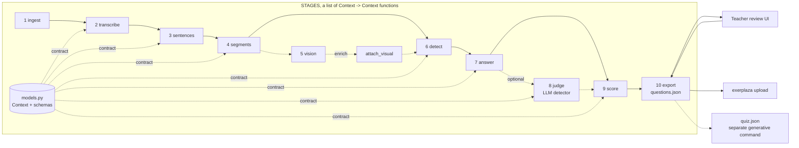

# Design decisions: M1 package foundation

Working document for the project report. It records *why* the architecture in
[architecture.md](architecture.md) looks the way it does: the drivers, the decisions, the
alternatives we rejected, and what an independent review changed. Each section notes which
report chapter it feeds (numbering follows the TDT4290 compendium's suggested structure).

> **One decision was later reversed.** The M1 foundation shipped a package-per-stage layout
> (`video/ audio/ detection/ models/ output/`) described in an earlier architecture document.
> The pipeline document, today's [architecture.md](architecture.md), then superseded it: the
> stage contract, not the directory, became the unit of ownership and replacement, and the
> earlier document was folded into architecture.md sections 13.1, 13.3 and 14. **D1** and **D2**
> below record that reversal rather than hiding it: the rejected alternative is kept, because the
> argument is the part worth reporting.

## 1. Drivers (→ report ch. 4 pre-study, ch. 6 requirements)

Four things shaped the design, roughly in order of weight:

1. **The customer's end-to-end vision.** The brief is not "detect questions"; it is detect →
   extract question *and* solution → store → review → upload to exerplaza. An architecture
   that only fits M1 would have to be reworked twice.
2. **The roadmap's modality shift.** M1 is audio-only; M2/M3 add slide/board understanding
   that *enriches* the audio questions; M3 also renders animations. The seams between stages had
   to be placed where those modalities join, not where today's code happens to split.
3. **How the team works.** Five people, ten weeks, two-week sprints, and issues #6–#18
   assigned to different members in parallel. Module boundaries double as ownership
   boundaries: an issue owner must be able to build inside one package against a fixed
   contract without stepping on anyone else.
4. **Course quality bar.** Modular, testable, installable on three OSes × four Python
   versions, with CI gates (tests ≥ 70 % coverage, ruff, mypy strict) on every PR.

Quality attributes we prioritised, in order: **modifiability** (M2, M3), **testability**
(each stage in isolation), **portability** (stdlib-only core, no native deps yet),
**interoperability** of the output (JSON as the contract with the review UI and exerplaza).
We deliberately did *not* optimise for throughput; hour-long lectures are batch jobs.

## 2. The shape in one picture (→ report ch. 7, figure)

Solid arrows are stages that run on every invocation; dashed ones are optional or M2+.
`models.py` is not a stage: it is the typed contract every stage reads and writes, and
`Context` is the single value threaded along the whole line. Export is not a stage either —
it runs on the finished `Context` (architecture.md 1.3).

## 3. Decisions and alternatives (→ report ch. 7)

Each entry: what we chose, what else we considered, why, and the cost we accepted.

### D1 — One module per stage, and a stage contract that is the real seam

*Chose (revised):* a flat module per stage — `media.py transcribe.py sentences.py segments.py
vision.py detect.py answer.py score.py llm.py` — each exposing exactly one `@stage`-decorated
`Context -> Context` function, with `pipeline.py` holding the `STAGES` list, the cache and the
progress plumbing.

*Alternatives:* (a) **package per stage** (`video/ audio/ detection/ models/ output/`) — what
M1 actually shipped, and what this reverses; (b) the original flat M0 layout with no stage
contract at all; (c) split by *feature* (`quiz/`, `transcript/`) rather than by stage.

*Why the reversal:* (a) put the boundary in the wrong place. What gets swapped is not a
directory but a *function*: a different ASR engine, a trained detector, a local OCR pass are
each one entry in `STAGES`, and a caller who wants one passes `stages=` a different list. Once
the contract carries that weight, a package per stage is a second, weaker boundary around the
same thing — five directories, five `__init__.py` files that are only docstrings, and an
`audio/transcripts.py` whose whole job (persisting the transcript) the runner's cache does
generically for every stage at once. The ownership argument for (a) survives intact and is
served just as well by one file per stage: issue owners still edit disjoint files.

*What (a) got right, and we kept:* stages are the units the issues are cut along; the order
lives in exactly one place; `models.py` is a contract, not a stage.

*Cost:* a flat `src/questxtract/` with sixteen modules, which will want grouping if the
package doubles. The `@stage` decorator also has to live in `models.py` rather than
`pipeline.py`, because `pipeline.py` imports every stage module to build `STAGES` and the
stage modules need the decorator — an import cycle otherwise (architecture.md 11.1).

### D2 — ~~`video/` is not `audio/`~~ (superseded by D1)

*Was:* container decoding (mp4 → audio track, later → frames) lives in `video/`; `audio/` is
speech-to-text only.

*Now:* moot. There are no `video/` and `audio/` packages. `media.py` owns decoding and the
source hash; `transcribe.py` owns ASR; `vision.py` owns frames. The underlying finding still
holds and is still honoured — **frame extraction must not sit under the ASR module**, because
M2/M3 read frames from the same container and would otherwise import the ASR module for it.

*Worth keeping in the report:* this was a review finding against the first draft (§5), and it
survived a later restructure that discarded the packaging it was expressed in. That is the
difference between a finding about *dependencies* and one about *directories*.

### D3 — Frozen, keyword-only dataclasses as the inter-stage contract

*Chose:* `Word`, `AsrSegment`, `Transcript`, `Sentence`, `Segment`, `VisualContext`,
`QuestionCandidate`, `QAPair` in `models.py`, `frozen=True, kw_only=True`, with `from_dict` and
a single `SchemaError`. `Context` is the one mutable object: the value each stage takes and
returns.

*Alternatives:* plain dicts; `TypedDict`; pydantic models.

*Why:* dicts push validation to every consumer and defeat mypy; pydantic would be the first
runtime dependency for something the stdlib does adequately at this size, and it would
couple every stage to one library's version. Keyword-only construction removes a whole class
of silent bugs when fields are added (a review finding showed `Question(...)` with positional
arguments would have stored the reasons tuple in the new `source` field without error).
Validation happens once, at the JSON boundary, and raises one error type the CLI can render.

*Cost:* hand-written `from_dict` per type. Acceptable at this size; revisit if the schema
grows much past ten types. The naming collision the restructure exposed is worth recording:
architecture.md calls a run of sentences a `Segment` while the ASR engine calls its own decoding
chunks segments too. We kept `Segment` for the former and named the latter `AsrSegment`,
because the sentence-run meaning is the one every downstream consumer uses.

### D4 — A fixed-key export envelope and stable ids

*Chose:* the export unit is one recording — `{"schema_version", "source", "config", "stats",
"questions": [...]}` (architecture.md 12.1) — every key always present, `null` included. Each
question carries an `id` derived from the `sentence_id` it was spoken in, and cites the
content-hash `sentence_id`s it came from.

*Alternative:* a bare list of questions (M0 behaviour); a `{"lecture", "questions"}` envelope
(the M1 `LectureResult`).

*Why:* the two downstream consumers both need identity: the review UI edits a question and
re-exports it; the exerplaza integration must *update* the quiz for a video, not create a
duplicate. Text is the field being edited, so it cannot be the key. The fixed key set means a
consumer never has to defensively `.get()` a missing `answer`. Sentence ids being *content
hashes rather than indices* is what lets a human edit survive a re-transcription (FR5).
The question `id` first hashed the question's start and text; once `--detector llm` could reword
the text, the id moved with every rewording, so #94 derived it from the spoken sentence instead.

*Cost:* an ASR re-run that shifts timestamps or words changes ids. We accept this: ids are
stable per *transcript*, and the transcript is cached (D8) precisely so it is not re-run.

### D5 — Forward-compatible schema: provenance, words, and the fields M2 fills

*Chose:* per-word timestamps on `Word` from day one; `reasons` on every candidate and pair;
`VisualContext` and the `QAPair` answer span as real types rather than reserved keys.

*Why:* every one of these is an *additive* change today and a *breaking* change once the
review UI and exerplaza mapping depend on the JSON. `words` in particular is what
sentence-accurate timestamps (FR7) need, and asking the ASR stage (#8) for them from day one
is free; retrofitting is not. We explicitly framed M2 as enrichment — visual understanding
fills board context on existing questions rather than emitting a second set — because the
roadmap and the brief say so, and because a second detector would need a merge step nobody
owns.

*What changed with architecture.md:* `visual_context` and `answer` stopped being reserved key
names and became `VisualContext` and `QAPair.answer_*`. The `Question.source` field was
dropped: with one detector and a `reasons` list that records every rule that fired, provenance
was already there.

**`reasons` is never dropped.** Every rule that fires, positive or negative, appends a stable
string. This is what makes review possible, what makes a wrong result debuggable without a
debugger, and what the judge reads as input.

### D6 — Where the package ends

*Chose:* inside — everything from decoding to quiz items on disk, *including* the planned
solution extraction (`answer.py`) and the quiz builder (a separate `questxtract quiz` command).
Outside — the review UI, exerplaza upload, and the evaluation *dataset*. See architecture.md 14 for
the boundary as stated to readers of the code.

*Why:* solution extraction needs the sentences *after* each question; if it lived in the UI, the
UI would re-implement pipeline logic. The UI and uploader, by contrast, only need the JSON. The
evaluation *dataset* is test material under `tests/data/`; the *harness* that reads it is library
code (`evaluate.py`), because NFR2 is a CI gate and the threshold sweep needs the pipeline.

*Kept sharp by the code, not only the prose:* generation lives in a separately named command
writing a separately named file, so "did this text come from the lecture?" is answerable by
looking at which file it is in.

*Tension to argue in the report:* general_requirements.md says the system "shall not create
questions on its own, only extract from questions asked", while the brief asks for a builder
producing MCQ/numeric items. Our reading: the builder *formats* an asked question (adds
distractors, normalises notation); it never invents a question. Confirm with the customer.

### D7 — Heuristic detector first, pluggable later

*Chose:* keep the M0 keyword heuristic (`?`, wh-word, auxiliary-verb start) as `detect.py`,
behind the one `Context -> Context` stage entry a classifier can replace.

*Why:* NFR2 sets the bar at ≥ 50 % recall on *our own* labelled set, which does not exist yet
(#11). Building a classifier before the evaluation set exists would be optimising blind. The
heuristic gives the rest of the pipeline something real to run on and gives #11/#12 a
baseline to beat. The literature we collected points the same way: the hard part of
video-based question generation is context selection on noisy ASR text, not the classifier.

### D8 — Persist the transcript; never recompute ASR for an edit

*Chose (revised):* one cache, written by the runner, keyed on the recording's content hash and
on the config values each stage declares in `uses=(...)` — `.questxtract/<hash>/transcribe.json`
and friends (architecture.md 11.2). The transcript is one entry in it, not a bespoke module.

*Why:* ASR is the expensive step (minutes per lecture, GPU if available). Edits, re-detection
with another threshold, and later enrichment must all run from the saved transcript. This is
also the sustainability argument (§7): compute once. Writing it once in the runner rather than
per stage means a new expensive stage gets correct caching by naming the config fields it reads.

*The one bug class this leaves:* a stage that gains a config field and forgets to list it in
`uses` will serve a stale entry. Keep `uses` next to the signature so the two are reviewed
together. Two related traps the implementation had to close: a run with no source hash must
skip the cache rather than share an `unknown/` bucket (one recording's results would replay
into another's), and the judge cannot key on config alone, because its input is the *candidate
set* (architecture.md 10.4).

### D9 — Errors at the boundary, readable at the CLI

*Chose:* `SchemaError` raised by `from_dict`/`read_*`; the CLI catches it (and `OSError`) and
prints one line, exit code 1.

*Why:* issue #17 requires readable errors and the first real users are lecturers, not
developers. Internally we still fail fast — no silent defaults.

### D10 — Quality gates are part of the architecture

*Chose:* uv for builds, ruff (lint + format), mypy `--strict`, pytest with a 70 % coverage
gate and `--import-mode=importlib`, CI on Linux, Python 3.10. Planned
modules are *not* scaffolded; the owning issue creates them against the documented boundary.

*Why:* with five part-time contributors the type checker and the tests are the review
capacity we do not have. The import mode choice is small but prevents a known pytest failure
(same-named test files in mirrored directories) that would otherwise appear the first time
`tests/integration/` is added.

### D11: Answers come from the LLM pass, not from rules

*Chose:* the rules stop at the adjacent seed (the sentence right after the question). Every answer
further away, refining a messy question, judging an answer and deduplicating echo pairs and near
duplicates is the one LLM pass (stage 9, architecture.md 10), with the board text in the prompt
when vision is on.

*Alternative:* the rule-based answer search of the original design: a forward window over the
next three sentences, a far-window rescue gated on shared keywords, an additive answer-scoring
table and token-overlap dedupe.

*Why:* the team found that answer finding can't be done reliably with rules. Whether a sentence
answers a question depends on context the rules only approximate with token overlap, while an
LLM that sees the question, the transcript around it and the board can judge it. It also folds
four rule sets into one pass that already had to exist to filter rhetorical questions.

*Cost:* without an endpoint, a question gets at most the adjacent seed as its answer. A drafted
answer is generated text, so it must cite the transcript sentences it comes from (architecture.md
10.3), and the customer has to accept LLM-drafted answers (#46).

*Revised by D12:* the LLM pass became the LLM detector, which also picks the questions. Its answers
are extractive, the cited sentences' own text, so no drafted answer text reaches the output.

### D12: An LLM detector the user picks per run, on the `openai` SDK alone

*Chose:* a second detector next to the rules (`--detector llm`, #88). A text LLM reads the
transcript in chunks of whole segments and answers with sentence ids, which the code checks against
the transcript (requirement 4.5). It picks the questions, cites the sentences that answer them and
may reword a messy question; the rules stay the default and the offline path. Local and hosted
models go through one client, the `openai` SDK with a `base_url`. Output is checked in three
layers: a JSON schema sent as `response_format` (constrained decoding on OpenAI, Ollama, vLLM and
llama.cpp), `json.loads` with one repeat, and the id checks in code. It is the first of two LLM
runs; the second, a VLM that brings the frames on screen into the question/answer pairs, comes
with the vision stage.

*Alternatives:*

- An LLM judge over the rule candidates only (#46, closed for this): cheaper, but the rules' recall
  becomes the ceiling, and that ceiling is what varies across lecture types and speakers (the
  dependence on Whisper's `?`, check-in lists grown from three recordings).
- litellm for the provider layer: a large dependency tree for providers we do not target, and its
  versions 1.82.7 and 1.82.8 were a supply-chain compromise on PyPI on 2026-03-24.
- pydantic-ai or LangChain: agent frameworks, for one request shape.
- instructor for validated output: re-asks on top of the same SDK, but pulls typer, rich, jinja2,
  aiohttp, tenacity and more. The SDK's own `.parse()` needs pydantic models at module level, which
  the base install lacks. The id checks have to be written either way.
- In-process local models (llama-cpp-python): no prebuilt wheels on PyPI, a risk for the Windows
  leg of NFR1. Torch runtimes are excluded anyway (architecture.md 13.2).

*Why:* the vision milestones build on the questions, so detection quality matters more than a
default that is offline in every mode. `base_url` already reaches every server we target (Ollama,
llama.cpp, vLLM, LM Studio), so a library on top would add dependencies without adding reach. No
new dependency was needed.

*Cost:* an LLM run needs an endpoint: cents per lecture for a hosted model, minutes of local
compute for a local one, and a context setting for Ollama (architecture.md 10.1). Once asked
for, the LLM is required: a
failed endpoint ends the run instead of falling back to the rules, so the output never silently
mixes the two.

*Revised by D13:* the model no longer lists the questions of a chunk; it judges candidates the code
chose, one decision each.

### D13: One decision per candidate, and kinds defined by what a question asks about

*Chose:* the LLM detector judges candidates the code chooses (every sentence ending in `?` plus
the rules' own), several nearby ones per request, each in a window of the lecture around it (#89,
architecture.md 10.2). The response schema requires exactly those candidate ids and lets an answer
cite only later sentences of the excerpt, so a constrained decoder can neither skip a candidate nor
invent an id. A candidate the lecture repeats three times or more carries its count, and each
judgement starts with a one-sentence `reason`. The prompt defines the kinds by what a question
asks about: `content` asks about the subject, whoever answers it.

*Alternative:* D12's first shape, which asked the model for the list of questions in each chunk of
transcript, with context lines from the neighbouring chunks.

*Why:* on the labelled set the rule candidates already held nearly every content question; the
small models' errors were judgement, not finding. They ended long lists early, mistyped ids, and,
as their `reason` showed, called any question the lecturer answers himself rhetorical and a
student's question restated in full procedural. An ablation separated the two changes: the
per-candidate shape with the old definitions changed nothing measurable, and the new definitions
in the old chunked shape did not help either; together they lifted the small models to where the
large one was. In chunks, the new definitions also let habitual tags ("True?") through, which the
repeat count keeps out. Numbers: #89's PR.

*Cost:* more requests than chunks, one per group of nearby candidates, so `judge_parallel` exists
for hosted runs. A question with neither a `?` nor a rule behind it is never judged. Thinking
helps the smallest models most, at minutes per request. The definitions were written after
reading misses on the labelled recordings, so they need a held-out recording to confirm them.

### D14: One endpoint module for the judge and vision, and vision is never required

*Chose:* the client and the request code both model calls need (a deadline on the whole call, one
resend, the per-request cache, the key hidden in errors) live in `endpoint.py`, which is not a
stage. Each stage keeps its own prompt, schema and output checks (#53, architecture.md 10). A
failed vision call leaves that one keyframe out with a warning; a failed judge request ends the
run.

*Alternative:* the vision call beside the judge in `llm.py`, as #53 first planned and PR #81
built.

*Why:* `llm.py` is the judge stage, so `vision.py` would have to import another stage, against
pipeline rule 1 (architecture.md 11.1). The judge is required once the user picks it (D12); a
board description only enriches questions the pipeline already found, so one unreadable keyframe
is no reason to stop a run of up to 80 calls.

*Cost:* one more module. A vision cache key hashes the whole keyframe, up to a few MB per request.

### D15: quiz.json v1 is single choice, origin-tagged, deterministic, and checked without jsonschema

*Chose:* a separate `quiz.json` with its own schema (#146, architecture.md 12.3), agreed with the
quiz command's owner (#79) and the exporters (#67, #37):

- Single choice only, at least three options: one correct and at least two distractors.
- Every text (stem, options, explanations) carries `origin`, `spoken` or `generated`. A stem is
  `spoken` only when it is the question as it was said, which for a question the LLM judge
  reworded is `original_text`, not `text`.
- No run timestamps, no absolute paths and no `feedback` block, so the same input gives a
  byte-identical file; exporters build feedback from `solution`.
- The source question id lives only in each item's `provenance`; the item id is derived from it,
  and two items may not share a source.
- `review.status` is `pending`, `accepted` or `rejected`.
- A runtime validator in plain Python for the rules JSON Schema cannot express; the schema
  itself is enforced with `jsonschema` in the tests only.

*Alternative:* `generated_at` and a `feedback` block per item, as in the first draft; a list of
source ids in `source`; `jsonschema` as a runtime dependency that checks everything at once.

*Why:* requirement 4.5 says the extraction never invents a question, so the one place that does
write new text must say which text that is, per field. A file that changes on every run cannot
be diffed or cached, and feedback derived from `solution` cannot drift from it. A second list of
source ids would be one more thing to keep in sync with the items. `rejected` replaces
`questions.json`'s `deleted` and `false_positive`, because a generated item is not a false
detection. `jsonschema` would add a runtime dependency for checks the writer's tests already make.

*Cost:* a reader that skips `read_quiz` gets no structural check at runtime. Spoken options and
explanations cannot be checked, because `quiz.json` holds no transcript.

### D16: QTI 3.0 from quiz.json, validated against the official XSDs in the tests only

*Chose:* `questxtract qti` reads `quiz.json` (D15), not `questions.json`, and writes QTI 3.0
only (#67, architecture.md 12.4). The tests validate every package they write against the
1EdTech XSDs, from a local copy that `scripts/fetch_qti_xsd.py` downloads once: the raw bytes of
all 17 files the two schemas import, each pinned by SHA-256, mapped from their URLs with
`xmlschema`'s `uri_mapper`. CI caches the copy and fails when it is missing.

*Alternative:* text-entry items from `questions.json`; QTI 2.x beside 3.0; the XSDs committed to
the repository; validation at runtime, always or behind a `--validate` flag; lxml, or
`xmlschema`'s own export of the schemas.

*Why:* `quiz.json` has what a scorable item needs (options, a correct answer, points,
explanations), and only a separate generative command may write that text (requirement 4.5).
The item XSD alone is 18 MB, about 1.5 MB compressed in every clone. lxml cannot follow the
schemas' `https` imports, and `xmlschema`'s export corrupts `XInclude.xsd`, which is served in
UTF-16. Validating in the tests proves the writer, whose output depends only on the quiz's
fields, without a runtime dependency or a network call on every export.

*Cost:* the XSD tests need the network once; offline, `ci-check.sh` skips them, so only CI is
sure to run them. A user's package is not validated when it is written, so the tests must cover
every shape the writer can produce.

### D17: CI runs on Linux and Python 3.10 only

*Chose:* one test job on `ubuntu-latest` with Python 3.10, the `requires-python` floor (#159).
The `ci` gate job keeps its name, so the required status check does not change.

*Alternative:* the 3 OS x Python 3.10/3.13 matrix; Linux with 3.10 and 3.13; self-hosted runners.

*Why:* the matrix started 6 jobs per push, macOS and Windows minutes bill at a higher rate than
Linux, and the team ran out of Actions credits (#158). The package is pure Python with no
system binaries, and mypy already checks against 3.10.

*Cost:* macOS, Windows and Python 3.13 support (NFR1) is claimed, not tested. `pathlib`,
`encoding="utf-8"` and the BOM handling stay in the code to keep it likely to work.

### D18: Reuse the reading of a page that comes back, and read again when unsure

*Chose:* within a run, a keyframe that shows the same page as one already read copies that
reading (#138, architecture.md 6.5). A share of changed pixels finds the candidate; a check of
mean brightness and colour in small squares at full resolution decides, with limits set from the
codec noise of TTK4225 2026-09-14: between frames of one page, and between its pages coming back
after H.264 encoding.

*Alternative:* the views' measure alone, a share of changed pixels; or a perceptual hash.

*Why:* both average a small change away. A new digit or decimal point is a few hundredths of a
percent of the page, and a colour change at the same brightness is none, so the earlier reading
would be copied over content that changed. A wrong copy puts stale text into a board state; a
missed copy only costs one model call. So whatever the check cannot tell from noise is read again.

*Cost:* the saving depends on the lecture. A tablet lecture whose pen cursor stays on the page
rarely shows a page unchanged twice, so it saves little; a slide deck the lecturer pages back
through saves the most. A mark fainter than the codec noise allows, about 48 grey levels of
contrast, can go unnoticed.

### D19: The board as a detection delta, built and left off

*Chose:* a candidate sharing a content word with the text of the board on screen gets
`board_overlap_delta` and the reason `board_overlap` (#60, architecture.md 7.3), measured on the
three reference recordings with committed board states (`eval --board`), and shipped at 0.0.

*Alternative:* ship it on at 0.10, as planned; or let the board lift sentences over the gate.

*Why:* with the delta on, recall, precision and F1 at the default threshold were unchanged. The
rule scores nearly every board-matching candidate 1.0 already, so a clamped additive delta has
nothing to add, and the two it did move were noise. Letting the board make candidates would
undo the gate's reason for being, that a question word without a `?` is a statement on these
recordings. The code stays: it is the measured negative result, it is one setting away for a
lecture where it helps, and the board states it reads are the input the VLM pass needs.

*Cost:* `source: "combined"` is not produced by default. The board states committed for the
eval are one model's reading and must be regenerated, not edited, when vision changes.

### D20: Score board reading by character error rate and formula recall, over lecture types

*Chose:* 30 labelled keyframes from six lectures whose licence or lecturer allows sharing, at
least 5 per lecture type (slides, blackboard, whiteboard, handwriting), each with its text,
formulas as LaTeX and a diagram line.
`eval --score-vision` scores the character error rate of the text and the share of labelled formulas
found in the answer's LaTeX, per lecture type (#58, architecture.md 4.4).

*Alternative:* word similarity against one reader's reference text on the two reference
recordings, as the model spike did (#52).

*Why:* QuestXtract has to read any teacher's board, so a number from two recordings says little;
the lecture types fail differently (chalk ghosts, a lecturer in front of a whiteboard, a webcam
column over tablet notes). Character error rate is the usual measure for reading text from
images and does not depend on how the answer splits words. Formulas are scored on their own
because the M4 animations need them as LaTeX, and prose that reads well can still drop them.

*Cost:* the labels were drafted by an LLM and wait for a human check. Recordings that allow
redistribution are mostly university lecture halls; a document camera over paper is not covered
yet. Diagrams are labelled but not scored.

### D21: Manim animations are optional, outside the core delivery

*Chose:* rendering board changes as Manim animations is optional and not part of the core
delivery (team decision, 21.10.2026, #171). M3's core is the board timeline: board states in
time order, linked to the questions asked while they were on screen.

*Alternative:* keep "Manim integration is demonstrated" as an M3 requirement, as the milestone
first stated, merged in from the former M4.

*Why:* nothing in the core delivery needs an animation: the questions, the board states and the
quiz are complete without one.

*Cost:* the customer's idea of animations made from the board's flow (milestone 4 in
general_requirements.md) is not delivered unless time is left. `latex` stays in each board state,
so a later Manim step can read it.

## 4. Requirements traceability (→ report ch. 6)

| Requirement (general_requirements.md) | Where it lands | Status |
|---|---|---|
| FR1 accept `.mp4` | `media.py` `ingest` (#7) | hash done, probe stubbed |
| FR2 extract audio track | none needed — `faster_whisper.audio.decode_audio` reads the container in process (architecture.md 2.1) | by design |
| FR3 transcribe with ASR | `transcribe.py` (#8) → `Transcript` | stub |
| FR4 extract drawing/animation from video | `vision.py` (M2/M3) | roadmap |
| FR5 teacher can edit after extraction | package side: fixed-key JSON with content-hash sentence ids (`export.py`); the editing UI itself is #15, a separate app (D6) | partial — export only |
| FR6 identify question sentences | `detect.py` (#10), or the LLM detector in `llm.py` (#88) | keyword heuristic, or an LLM per run |
| FR7 start timestamp per question | `QAPair.start`, a slice of the word list — word-accurate by construction, never interpolated (architecture.md 2.5) | done |
| FR8 export JSON | `export.py`, architecture.md 12.1 (#13) | done |
| FR9 progress for long recordings | `Progress = Callable[[str, float], None]`, emitted once per stage by the runner (#14) | done for stage granularity |
| FR10 show detection confidence | `QAPair.confidence` + `confidence_label` + `reasons` | done |
| FR11 filter by time/topic | time: `filter_questions` / `filter_document` over `QAPair.start` / exported `start`, half-open `[start, end)` (#16). topic: experimental `topic=` on the same functions, matching `segments[].topic`; `Segment` is a *time* unit, not a topic one (architecture.md 3.2), so the label is still missing | time done, topic unbacked (experimental hook) |
| NFR1 Python ≥ 3.10, Linux/macOS/Windows | Linux CI on Python 3.10 (macOS, Windows untested); no system binaries, no ffmpeg on PATH | done |
| NFR2 recall ≥ 50 % on labelled set | #11 dataset under `tests/data/`, `evaluate.py` harness (#12) | stub |
| NFR3 docstrings, type hints, tests, ≥ 70 % coverage | ruff `D` rules, mypy strict, pytest gate | done |
| NFR4 tested on every PR | GitHub Actions (#19) | done |
| Constraint: never invent questions | the rules extract verbatim spans; the LLM detector answers with sentence ids checked against the transcript, may reword but never add, and the spoken text stays as `original_text`; generation is a separate command (architecture.md 1.4, 10.3, 12.3) | by design |

## 5. The review and what it changed (→ report ch. 7, ch. 12 "AI")

Before merging the M1 layout we ran a structured, AI-assisted review of the architecture
PR: ten independent "finder" passes (line-by-line, removed behaviour, cross-file callers,
language pitfalls, reuse, simplification, efficiency, altitude/fit, conventions), each
candidate then checked by a separate verifier against the code, the issues and the customer
brief, then a final sweep for gaps. 22 candidates were verified, one refuted, 15 applied.

What it changed, in order of consequence:

| Finding | Change | Decision affected |
|---|---|---|
| Solution extraction and question builder had no home | added as stages 7 and a separate `quiz` command | D6 |
| Video decoding filed under `audio/` | decoding kept out of the ASR module | D2 |
| No identity for edits/upload | question `id` + content-hash sentence ids | D4 |
| Word timestamps dropped at the ASR boundary | `Word`, and words as the atomic unit | D5 |
| `source` framed M2 as a second detector | documented as enrichment of existing questions | D5 |
| Positional construction would silently misassign a new field | `kw_only=True` | D3 |
| Malformed transcripts produced tracebacks | `SchemaError` + one-line CLI errors | D9 |
| Nested test dirs would collide on same-named files | `--import-mode=importlib` | D10 |
| Transcript I/O lived in `output/`; no way to persist transcripts | the runner's one cache | D8 |
| Progress reporting (#14) unplaced | `Progress` callable, emitted by the runner per stage | — |
| Status table said "done" for open issues; README contradicted the non-goals; rename unflagged | doc/README/CHANGELOG corrections | — |
| Non-ASCII first word skipped by the tokeniser; int confidence at threshold 0 | `\w+` + `casefold()`, float seed | D7 |
| `output/json.py` shadowed the stdlib module | renamed, then folded into `export.py` | — |

Two more surfaced while moving the code onto the stage contract, both of which the packaging
had hidden rather than caused:

| Finding | Change | Decision affected |
|---|---|---|
| A cached stage with no source hash shared one `unknown/` bucket, replaying one recording's results into another's | skip the cache when there is no content hash | D8 |
| `judge` declared `cache="pairs"` but its `uses` header holds only config, so a stale verdict would survive a detection change | judge caches only once keyed on the candidate set (architecture.md 10.4) | D8 |

The one refuted candidate ("the empty `audio/` package contradicts the no-scaffolding rule")
is worth mentioning in the report as an example of why verification matters: the rule is about
planned *modules*; package boundaries are deliberately created early.

**Reflection for the AI section.** The review's value was not bug-finding — the diff was a
reorganisation with almost no logic — but *fit-checking the design against documents the code
cannot see*: the customer brief, the open issues, the roadmap. That is the part of a review a
student team most often skips under time pressure. Two responsible-use points: every finding was
verified against a concrete line, issue or requirement before we acted on it, and the decisions
(e.g. keeping the builder inside the boundary, choosing a changelog over a version bump) were
made by us, not adopted from the tool. The tool also produced wrong details along the way (it
asserted a `--model` CLI flag that does not exist), which the verification step caught.

## 6. Security at the design level (→ report ch. 9; compendium touchpoints 2, 5, 6)

*Assets:* lecture recordings and transcripts (may contain names and voices of students —
personal data under GDPR if real lectures are used); the extracted question bank; later, the
exerplaza credentials used by the uploader.

*Threats (STRIDE, the relevant ones):*
- **Tampering** — an edited or hand-crafted results/transcript JSON is re-imported. Mitigated
  by schema validation (`SchemaError`); *not* mitigated: integrity or provenance of edits. Fine
  for a local tool; revisit if files travel between users.
- **Information disclosure** — transcripts leaving the machine. Design choice: ASR runs
  offline (customer brief: "offline speech-to-text, e.g. Whisper") and never over a hosted
  transcribe endpoint. The optional LLM layer (architecture.md 6 and 10) is the one component that
  *can* leave the machine, and only when the caller configures an endpoint: the default
  `Config` makes zero outbound calls, and every result the pipeline produces is reachable
  without one. Pointing `base_url` at a local OpenAI-compatible server keeps even that on the
  device. The uploader (outside the package) is the only component that always talks out.
- **Denial of service / resource exhaustion** — hour-long inputs, temp files from decoding.
  #7 owns temp-file cleanup; #14 progress reporting is also the cancellation point.
- **Elevation of privilege / spoofing** — none inside the package: no accounts, no privileges.
  Both reappear at the exerplaza boundary and should be threat-modelled with that module.

*Abuse cases to write up:* (1) a malicious transcript file (deeply nested JSON, huge strings)
fed to the CLI; (2) a lecturer uploading someone else's lecture; (3) a review UI user injecting
LaTeX/HTML into a question that exerplaza renders.

*Security requirements to state:* **S1 no network access unless the caller configures an
endpoint** — the default `Config` makes zero outbound calls, the pipeline produces a complete
result without one, and ASR is local always (this is the narrowed form; the original blanket
"no network access in `questxtract` itself" was incompatible with the optional LLM layer the
design needs for handwriting and board diagrams, and a blanket rule nobody can keep is worse
than a precise one that holds); S2 all external JSON validated before use; S3 credentials never
stored in the package or the result files — the API key is read from the environment at call
time and is not a `Config` field; S4 temporary media deleted after extraction; S5 test material
is public or mock lectures only (the brief already promises "no student data"); **S6 when an
endpoint is configured, the user must be able to tell** — the exported `config` block names the
models used, so a result carries whether it went out.

Suggested exercise for the report: play Microsoft EoP over the figure in §2 with the
information-flow arrows — the compendium asks for an architecture sketch with flows first.

## 7. Sustainability and diversity hooks (→ report ch. 12, ch. 13-style reflections)

- **Compute once.** Persisting transcripts (D8) and keeping ASR offline means the expensive
  step runs once per lecture rather than per edit or per threshold change. Worth quantifying
  in the report (minutes of GPU/CPU per hour of lecture × number of re-runs avoided).
- **Read a page once.** Within a run, a slide that comes back unchanged copies its earlier
  reading instead of another vision call (D18). `stats.vision_reused` counts the readings copied;
  each is a call saved unless the request cache would have answered it anyway.
- **Small dependency footprint.** The core is stdlib-only; heavy models are isolated in
  `transcribe.py` and `vision.py`, and the LLM client is an optional `[llm]` extra imported
  inside the function that needs it, so a transcript-only user never installs any of them.
  There is no torch anywhere in the base install (architecture.md 13.2).
- **Software sustainability (maintainability).** Typed contracts, one error type, one test
  module per source module, and the pipeline document itself are what let the customer build on
  the code after the semester (a graded criterion). The document is load-bearing rather than
  decorative: a test asserts that `STAGES` matches the stage order it specifies.
- **Diversity dimensions the design touches.** Language: the requirements assume English
  lectures; the tokeniser fix (non-ASCII first words) is a small but real example of an
  assumption that excluded non-native names and fillers. Accessibility: per-word timestamps
  make the same output usable for captions/navigation. Pedagogy: the "extract, never invent"
  rule keeps the lecturer in control of what students are quizzed on.

## 8. Sources worth citing (verify each before use)

Collected in the team's research notes; check every entry on Google Scholar before it goes
in the bibliography (some came via an AI-generated literature survey).

- Context selection and rewriting for video-based educational question generation —
  AAAI 2025 (arXiv:2504.19406). *Supports D7: the bottleneck is context on noisy ASR text.*
- Chapter-Llama: efficient chaptering in hour-long videos with LLMs (arXiv:2504.00072).
  *Supports the text-first pipeline over end-to-end vision-language models.*
- FCN-LectureNet: extractive summarization of whiteboard and chalkboard lecture videos;
  LEARNet (Entropy, 2026). *Background for `visual/` in M2/M3.*
- MAGMA-Edu and "Hallucination-free automatic question & answer generation" (arXiv:2511.18714,
  arXiv:2601.14280). *Argument for validation stages around any LLM in `builder/`.*
- IEEE Std 830-1998 (requirements); Sommerville, *Software Engineering* 10th ed. (modular
  design); McGraw, "The 7 touchpoints of secure software"; Microsoft STRIDE / EoP.
